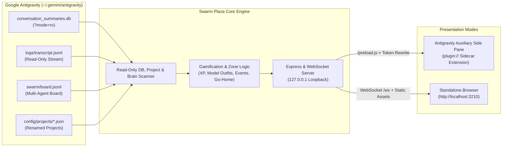

# Antigravity Swarm Plaza 🏢🎮

[](https://github.com/akinba/antigravity-swarm-plaza/actions/workflows/ci.yml)
[](https://github.com/akinba/antigravity-swarm-plaza/releases)


🇬🇧 **English** | [🇹🇷 **Türkçe**](README.tr.md) | [🇨🇳 **简体中文**](README.zh-CN.md)

> A 2.5D retro isometric gamified dashboard and native IDE Auxiliary Pane sidecar extension that visualizes Google Antigravity autonomous multi-agent systems and swarms as living, breathing office workers across skyscraper floors.

---

## 📸 Visual Showcase Gallery

<p align="center">
  
</p>
<p align="center">
  <em>🎬 <strong>Live Demo Walkthrough</strong> — 2.5D Day Office → Night Mode &amp; Star Wars Costume Party → Plaza Tower Exterior.</em>
</p>

<p align="center">
  
</p>
<p align="center">
  <em>🏢 <strong>Main 2.5D Isometric Office (Daylight)</strong> — Acoustic wood-slat walls, panoramic skyline windows, diverse female &amp; male pixel employees, dual-monitor desks, and mini-room props.</em>
</p>

<table>
  <tr>
    <td width="50%" align="center">
      <strong>🌙 Alternate Blueprint, Night Mode &amp; Events</strong><br /><br />
      <br />
      <em>Alternate 16×14 floor layout, ambient night light pools, and live floor events</em>
    </td>
    <td width="50%" align="center">
      <strong>🏙️ Plaza Tower Skyscraper Exterior</strong><br /><br />
      <br />
      <em>Curtain-wall glass facade, neon SWARM PLAZA crown, double-height lobby, and elevator</em>
    </td>
  </tr>
  <tr>
    <td width="50%" align="center">
      <strong>🕸️ Live Swarm Board &amp; <code>@mention</code> Graph</strong><br /><br />
      <br />
      <em>Auto-scrolling message feed with clickable <code>● LIVE</code> follow and directed <code>@mention</code> graph</em>
    </td>
    <td width="50%" align="center">
      <strong>📊 60-Minute Analytics &amp; Telemetry</strong><br /><br />
      <br />
      <em>60-minute activity bar chart, completed task counters, and model distribution</em>
    </td>
  </tr>
  <tr>
    <td width="50%" align="center">
      <strong>⚙️ Game-Style Graphics &amp; System Settings</strong><br /><br />
      <br />
      <em>One-click FPS/DPR profiles (60 FPS Classic default), AA, static cache, and system toggles</em>
    </td>
    <td width="50%" align="center">
      <strong>📅 Vertical Gantt &amp; Swarm Whiteboard</strong><br /><br />
      <br />
      <em>Side-by-side agent swimlanes, real date blocks, HH:MM timeline, and Personnel Roster</em>
    </td>
  </tr>
</table>

<table>
  <tr>
    <td width="310" align="center">
      
    </td>
    <td valign="middle">
      <strong>📱 IDE Auxiliary Side-Pane Compact Mode (<code>&lt; 760px</code>)</strong>
      <ul>
        <li><strong>Compact Toolbar:</strong> Secondary controls automatically bundle into a clean <code>⋯</code> overflow menu.</li>
        <li><strong>Slide-Over Floor Drawer:</strong> Floor selector collapses into a quick <code>ELEVATOR ▾</code> drawer to save horizontal space.</li>
        <li><strong>Full-Width 2.5D Office:</strong> Preserves crisp 100% canvas visibility inside narrow IDE side panes.</li>
        <li><strong>Companion Navigation Pill:</strong> Bundled <code>plugin/rules/AGENTS.md</code> surfaces <code>[Swarm Plaza](sidecar://antigravity-swarm-plaza/swarm_plaza/)</code> right alongside <code>Open the Swarm UI</code>.</li>
      </ul>
    </td>
  </tr>
</table>

---

## 🏛️ Architecture



---

## 🌟 Key Features & What's New (v1.3.2)

- **🧭 Unified Workflow & Vertical Gantt (`🧭 WORKFLOW & GANTT`) with Curved Bezier SVG Topology:**
  - Combines the interactive `@mention` handoff topology and Vertical Gantt timeline into a single unified tab (`WorkflowDiagramSvg.tsx`), featuring an amphitheater blueprint layout (`★ BOSS HUB`, `@all` broadcast node, role-colored agent cards), non-overlapping quadratic Bezier arrows with `×N` frequency badges, and bidirectional click-to-filter sync with the scrollable `HH:MM` Gantt rows below.
- **🚨 Clickable Topbar `! N` Error Badge, Smart Alert Center & `📜 Go to Logs` Inspection Flow:**
  - Displays a live pulsing red **`! N`** badge in `TopHud` whenever active floor employees encounter errors or health stalls; clicking opens `AlertHistoryModal` with `×N` grouping, severity filters, and **`🔍 INSPECT AGENT`** to jump straight into the agent's RPG Card—complete with a top red error banner (`⚠️ Error detected • N consecutive errors`), `HP` badge, and one-click **`📜 GO TO LOGS`** highlighting `ERROR` steps.

- **⚙️ Game-Style Graphics & System Settings + Decluttered Top Bar:**
  - Dedicated **`⚙️ SETTINGS`** modal with one-click performance presets (**`⚡ Classic Smooth 60 FPS`** default, `⚖️ Balanced 30 FPS`, `🌱 Power Saver Eco`, `🔥 Ultra Native`), Resolution Scale (`0.75x` / `1.0x` / `2.0x` / `Native DPR`), Anti-Aliasing (`Pixel Crisp` / `Smooth`), Frame Rate Limit (`Eco 14–24` / `30` / `60` / `Unlimited`), Static Architecture Cache toggle, and a **Live FPS** readout.
  - Decluttered desktop toolbar keeping only core navigation and floor actions, while moving `Follow Cam`, `Day/Night`, `Demo Mode`, `SFX`, `Browser Alerts`, and `TR/EN` into Settings with `localStorage` persistence.

- **👥 Illustrated Personnel Roster (`👥 PERSONNEL ROSTER`) & Back-to-List RPG Navigation:**
  - Live `64×64` 2.5D pixel-art portraits for every active agent on the floor, paired with current activity/task summary, model badge, `~Estimated` credit & token usage, `HP` health bar, and one-click RPG Card inspection with a top-left **`⬅ BACK TO LIST`** button to jump straight back to the roster.
- **📅 Vertical Gantt Work Plan (`📅 WORK PLAN (GANTT)`):**
  - Side-by-side agent columns on the horizontal axis and real date blocks (`📅 YYYY-MM-DD`) with an `HH:MM` clock timeline on the vertical axis, color-coded phase blocks (`📊 Plan`, `🔍 Analyze`, `💻 Code`, `🧪 Test`, `☕ Break`), and a **`⬆️/⬇️` flow direction toggle**.
- **📋 Task Flow (`📋 TASK FLOW (DAG)`) & Golden Desk Verification Trophies:**
  - Active-scene-only `@mention` handoff graph, task cards, and golden pixel verification trophies (`drawDeskVerifiedTrophy`) that appear on 2.5D desks when agents report `PASS / DONE / EXIT 0 / ✅` proof.
- **🛡️ Agent Health (`0–100 HP`), `~Estimated` Cost Monitor & `×N` Smart Alert Grouping:**
  - Passive micro-HP bars on agent cards and desks, `~Estimated` token & cost breakdown in `AnalyticsModal`, and filterable alert notifications that deduplicate repeated alerts with `×N` badges.
- **⚡ Eco-Canvas GPU Optimizer & Smart Break Events:**
  - Offscreen static architecture cache + Adaptive FPS Limiter (`0 FPS` when hidden, `4 FPS` behind open modals, `14–24 FPS` active scene) cutting GPU usage by ~85%, plus a minimum 2-agent-on-break rule (`MIN_BREAK_AGENTS_FOR_SOCIAL_EVENT = 2`) and `150s` inter-event cooldown for automatic social/costume events.

- **🧩 Embedded Antigravity Auxiliary Pane UI Extension (Sidecar):**
  - Runs natively inside the Antigravity IDE Auxiliary Side Pane with one-click launch via `[Swarm Plaza](sidecar://antigravity-swarm-plaza/swarm_plaza/)`.
  - Automatically binds to Antigravity's dynamic port (`ANTIGRAVITY_SIDECAR_WEB_PORT`) with `127.0.0.1` loopback security and `X-Sidecar-Token` authentication.
  - Transparent HTML asset token rewriting (`rewriteHtmlWithSidecarToken`), `/preload.js` bridge, and a 1500ms HTTP polling fallback to ensure flawless rendering under Electron's `plugin://` scheme without white flashes.
  - **Responsive Compact Mode (`< 760px`):** Narrow side panes automatically collapse the floor panel into a slide-over drawer (`ASANSÖR ▾`), bundle secondary actions into a `⋯` menu, and preserve 100% full-width isometric canvas rendering.
- **🏢 Plaza Skyscraper & Fixed Elevator Foyer:**
  - Every Antigravity project maps to its own dedicated company floor (`K0` Lobby, `K1..KN` Projects, and Penthouse Demo Floor).
  - Automatically resolves user-renamed Antigravity project display names from `~/.gemini/config/projects/*.json` (e.g. `"Bursa Veriler"`).
  - Fixed left-wall elevator entrance (`gx: 0, gy: 6..7`) across all blueprints with brushed-steel sliding doors that open when agents arrive or depart.
- **👔 BOSS, Diverse Male & Female Pixel Characters & 8 Model Outfits:**
  - Swarm coordinators are prominently styled as **★ BOSS** seated at an executive mahogany desk with a golden crown.
  - Expressive female & athletic V-taper male 2.5D pixel employees (oval chibi faces, eye sparkle, wavy/bob/ponytail/bun female hairstyles, 3-tier flared skirts & tailored suits; 3 male outfits `classic_suit` / `tech_hoodie` / `vest_ensemble`, 4-layer voluminous hair, focused gaze, optional `light_stubble`) paired with synchronized `96×96` RPG character portraits.
  - 8 distinct model families feature unique outfits and accessories: `argon` (Purple blazer + crown), `hydrogen` (Cyan tech hoodie + headphones), `flash` (Emerald/Yellow racing jacket + visor), `carbon` (Crimson lab coat + cyber specs), `pro` (Navy/Gold suit + tie), `claude` (Terracotta knit sweater + beanie), `gpt` (Teal turtleneck + headset), `other` (Indigo polo + badge).
- **📐 Full 2.5D Office Architecture, Ambient Lighting & 5 Mini-Room Props:**
  - Richly textured floors (warm parquet, acoustic carpet, perforated server metal, marble lobby), acoustic wood-paneled & panoramic city-view back walls, beveled dual-monitor desks, ergonomic chairs, espresso bar, soft contact shadows, window/server/lounge radial light pools, and a refreshed `PLAZA TOWER` glass curtain-wall facade.
  - Real partitioned rooms (Executive Suite, Dev/QA Studio, Conference War Room, Server Room, and Lounge) plus 5 custom 2.5D mini-room props (`phone_booth`, `snack_vending`, `arcade_cabinet`, `library_table`, `3d_printer`) filling dead zones across `16×14` floors.
  - 100% camera-facing (`SE` / `SW`) seated angles, low tabletop ergonomics (`10px`), and corner monitors ensure characters' faces and expressions are never occluded.
  - 5 theme palettes across 5 architectural layouts yield 25 distinct combinations (`🎲 LAYOUT`).
- **☕ Living Agent Lifecycle & Go-Home Timer (`AGY_GO_HOME_MINUTES`):**
  - **Seated Keyboard Coding:** Ergonomic swivel chairs, mechanical keyboard typing, and floating `</>` code glyphs.
  - **War Room Presentations & Teleportation:** Active speaker holds a laser pointer stick directing attention to the illuminated Presentation Screen (`presenting`), while invited teammates teleport in via 2.5D pixel beam & isometric rings (`playTeleportZap()`) or sit as attentive listeners (`meeting`).
  - **Lounge Relaxation & 2-Player Console Gaming:** Idle agents relax on plush sofas (`lounging`) or pair up for retro console fighting/racing games (`gaming`).
  - **Shift End / Go-Home:** Agents inactive for `8` minutes walk toward the elevator (`going_home`), leaving the office at `9.5` minutes to complete their shift (`offDutyCount`).
- **⚡ Random Office Events & Costume Parties (`⚡ EVENT` & 65s Auto-Loop):**
  - `STAR_WARS_PARTY` (Jedi, Sith, Rebel, Mandalorian), `SUPERHERO_PARTY`, and `HALLOWEEN_PARTY` (Witch, Pumpkin, Vampire, Ghost) with 4 deterministic costume variants per agent, ambient canvas particles, and synchronized 96x96 RPG portraits, alongside `PIZZA_PARTY`, `WATERCOOLER_GOSSIP`, `SPRINT_CELEBRATION`, `MASCOT_ZOOMIES`, and `COFFEE_BREW`.
  - *Real-Work Integrity:* Active working agents (`status === 'working'`) are NEVER pulled off their desks during ambient events.
- **📡 Live Swarm Board, `@mention` Network Graph & 60m Analytics:**
  - Unified message stream ingesting both Native Swarm `board.jsonl` and subagent/task `messages/*.json`, with automatic scroll-to-latest (`MESSAGE FEED`), clickable `● LIVE` follow toggle, and clean `@Swarm Worker (...)` badge normalization.
  - Directed `@mention` communication network graph modal (`WhiteboardModal`) + **`TASK FLOW (DAG)`** tab tracking task ownership, handoffs, and keyword-verified proof badges (`PASS`, `DONE`, `EXIT 0`, `VERIFIED`, `✅`).
  - **Operational AI Agent Control Center:** Passive **Agent Health (0–100 HP)** micro-bars, golden desk proof trophies for verified outputs, `~Estimated` per-agent Token & Cost Monitor (`AnalyticsModal`), and Smart Alert Grouping (`×N` deduplication + severity filters).
  - 60-minute activity telemetry timeline (12x 5-minute buckets), completed task counters, and model distribution (`AnalyticsModal`).
- **🌐 Automatic Browser Language Detection & Complete i18n:**
  - Automatically starts in Turkish if browser/OS language is Turkish (`tr*`), otherwise defaults to English (`en`). Instant `TR | EN` toggle updates all server speech bubbles, demo company names, and event titles in real time.
- **🛡️ 100% Read-Only Safety:**
  - Strictly read-only: SQLite uses `?mode=ro`, transcripts and brain directories are scanned via read-only file streams. Never writes, locks, or alters user data in `~/.gemini/antigravity`.

---

## 📐 Architectural Blueprints & Pets Table

| Blueprint | Layout Name | Desk Ergonomics | Room Partitioning | Office Pet & Amenity |
| :--- | :--- | :--- | :--- | :--- |
| **0** | **Classic Corner Studio** | `clover_desk` (4-person Clover Pod) | Glass Partitions | Aquarium (Swimming fish & bubbles) |
| **1** | **Central Meeting Island** | `single_desk` (Spaced Individual Desks) | Wood Partitions | Tabby Cat (`tabby_cat`) & Cozy Poufs |
| **2** | **Open L-Plan Tech Lab** | `bench_desk` (Startup Bench Row) | Hybrid Partitions | Robo-Vac (`robo_vac`) & Ping-Pong Table |
| **3** | **Dual-Wing Corporate** | `u_pod_desk` (U-Shaped Team Pod) | Full Glass Walls | Office Dog (`office_dog` - Corgi) |
| **4** | **Creative Penthouse Loft**| `twin_desk` (Paired Duo Desks) | Brick & Wood | Tuxedo Cat (`tuxedo_cat`), Bonsai & Aquarium |

---

## ⚡ Instant Run (`npx`)

### Try in 1 Command (Zero Clone)

Run immediately from GitHub or npm without cloning or manual build steps (Node.js `>= 22.5.0` required):

```bash
# Run directly from GitHub in interactive demo mode
npx github:akinba/antigravity-swarm-plaza --demo

# Or via npm package
npx antigravity-swarm-plaza --demo
```

### CLI Command Flags

| Flag | Short | Description |
| :--- | :--- | :--- |
| `--demo` | `-d` | Starts with interactive demo mode enabled (5 Pure-Gemini model agents) |
| `--port <n>` | `-p <n>` | Sets a custom HTTP/WebSocket port (default: `3210` or `$PORT`) |
| `--no-open` | | Disables automatic browser launch on startup |
| `--workspace <path>` | `-w <path>` | Highlights a specific workspace directory as the active floor |
| `--install-plugin` | | Installs the extension into `~/.gemini/config/plugins/antigravity-swarm-plaza` |
| `--help` | `-h` | Displays CLI usage help |
| `--version` | `-v` | Prints current version number |

---

## 🧩 Antigravity Extension Installation (IDE Sidecar)

To install Swarm Plaza as a native Auxiliary Pane extension and skill directly inside Google Antigravity:

```bash
npx antigravity-swarm-plaza --install-plugin
```

Once installed, simply click the sidecar pill in Antigravity chat:
- `[Swarm Plaza](sidecar://antigravity-swarm-plaza/swarm_plaza/)`
- When the plugin is installed and enabled, its bundled `plugin/rules/AGENTS.md` rule automatically surfaces the companion `[Swarm Plaza](sidecar://antigravity-swarm-plaza/swarm_plaza/)` pill alongside `[Open the Swarm UI](sidecar://swarm/swarm_board/)` (and disappears automatically when the plugin is disabled).

---

## 🚀 Development & Test Suite

```bash
# Clone repository
git clone https://github.com/akinba/antigravity-swarm-plaza.git
cd antigravity-swarm-plaza

# Install dependencies
npm install

# Run automated tests (73 tests / 25 test suites)
npm test

# Run TypeScript verification
npm run typecheck

# Build client, server, and sidecar bundle
npm run build

# Start standalone server
npm start
```

---

## ⚙️ Environment Variables

| Variable | Default | Description |
| :--- | :--- | :--- |
| `PORT` | `3210` | Web server and WebSocket port |
| `ANTIGRAVITY_SIDECAR_WEB_PORT` | | Dynamic port assigned by Antigravity for the auxiliary pane (takes priority) |
| `HOST` | `127.0.0.1` | Local loopback bind host for security |
| `AGY_DATA_DIR` | `~/.gemini/antigravity` | Antigravity root data directory (read-only inspection) |
| `AGY_WORKSPACE` | `process.cwd()` | Workspace path used to detect and highlight the active project floor |
| `AGY_GO_HOME_MINUTES` | `8` | Inactivity threshold before agents head to the elevator (minutes) |

---

## 📄 License

MIT License. Designed and crafted for the Google Antigravity Multi-Agent Ecosystem.
