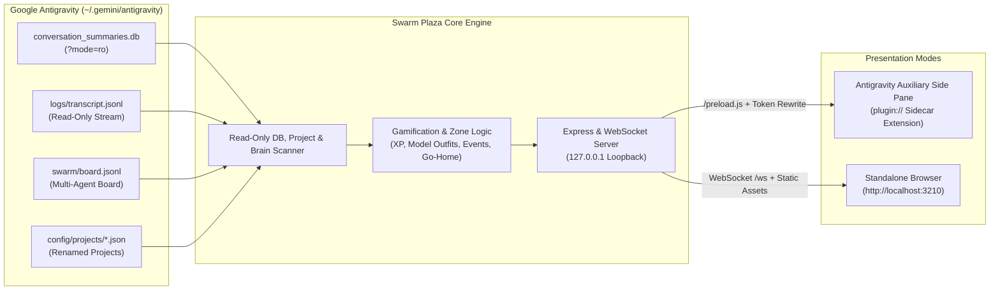

# Antigravity Swarm Plaza 🏢🎮

[](https://github.com/akinba/antigravity-swarm-plaza/actions/workflows/ci.yml)
[](https://github.com/akinba/antigravity-swarm-plaza/releases)

🇬🇧 **English Documentation** | [🇹🇷 **Türkçe Dokümantasyon**](README.tr.md)

> A 2.5D retro isometric gamified dashboard and native IDE Auxiliary Pane sidecar extension that visualizes Google Antigravity autonomous multi-agent systems and swarms as living, breathing office workers across skyscraper floors.

---

## 📸 Visual Showcase Gallery

| 🏢 Main 2.5D Isometric Office (Daylight) | 📱 IDE Auxiliary Side-Pane Compact Mode | 🌙 Alternate Architecture & Night Mode |
| :---: | :---: | :---: |
|  |  |  |
| *Executive desk, cluster pods, elevator foyer, and animated pets* | *< 760px Aux Pane compact toolbar, elevator drawer, and full-width office* | *Central Meeting Island, night ambiance, and Floor Pizza Party event* |

| 🏙️ Plaza Tower Exterior View | 🕸️ Swarm Board & `@mention` Graph | 📊 60-Minute Analytics & Telemetry |
| :---: | :---: | :---: |
|  |  |  |
| *Skyscraper floors, illuminated active windows, and glass elevator* | *Live message feed and directed `@mention` network interaction graph* | *60-minute activity bar chart, task completion, and model distribution* |

---

## 🏛️ Architecture



---

## 🌟 Key Features & What's New (v1.2.0)

- **🧩 Embedded Antigravity Auxiliary Pane UI Extension (Sidecar):**
  - Runs natively inside the Antigravity IDE Auxiliary Side Pane with one-click launch via `[Swarm Plaza](sidecar://antigravity-swarm-plaza/swarm_plaza/)`.
  - Automatically binds to Antigravity's dynamic port (`ANTIGRAVITY_SIDECAR_WEB_PORT`) with `127.0.0.1` loopback security and `X-Sidecar-Token` authentication.
  - Transparent HTML asset token rewriting (`rewriteHtmlWithSidecarToken`), `/preload.js` bridge, and a 1500ms HTTP polling fallback to ensure flawless rendering under Electron's `plugin://` scheme without white flashes.
  - **Responsive Compact Mode (`< 760px`):** Narrow side panes automatically collapse the floor panel into a slide-over drawer (`ASANSÖR ▾`), bundle secondary actions into a `⋯` menu, and preserve 100% full-width isometric canvas rendering.
- **🏢 Plaza Skyscraper & Fixed Elevator Foyer:**
  - Every Antigravity project maps to its own dedicated company floor (`K0` Lobby, `K1..KN` Projects, and Penthouse Demo Floor).
  - Automatically resolves user-renamed Antigravity project display names from `~/.gemini/config/projects/*.json` (e.g. `"Bursa Veriler"`).
  - Fixed left-wall elevator entrance (`gx: 0, gy: 6..7`) across all blueprints with brushed-steel sliding doors that open when agents arrive or depart.
- **👔 BOSS & 8 Model-Specific Outfits & Colorways:**
  - Swarm coordinators are prominently styled as **★ BOSS** seated at an executive mahogany desk with a golden crown.
  - 8 distinct model families feature unique outfits and accessories: `argon` (Purple blazer + crown), `hydrogen` (Cyan tech hoodie + headphones), `flash` (Emerald/Yellow racing jacket + visor), `carbon` (Crimson lab coat + cyber specs), `pro` (Navy/Gold suit + tie), `claude` (Terracotta knit sweater + beanie), `gpt` (Teal turtleneck + headset), `other` (Indigo polo + badge).
- **📐 5 Architectural Blueprints, 5 Desk Styles & Office Pets:**
  - Real partitioned rooms (Executive Suite, Dev/QA Studio, Conference War Room, Server Room, and Lounge) plus dead-zone mini rooms and corner nooks.
  - 100% camera-facing (`SE` / `SW`) seated angles, low tabletop ergonomics (`10px`), and corner monitors ensure characters' faces and expressions are never occluded.
  - 5 theme palettes across 5 architectural layouts yield 25 distinct combinations (`🎲 LAYOUT`).
- **☕ Living Agent Lifecycle & Go-Home Timer (`AGY_GO_HOME_MINUTES`):**
  - **Seated Keyboard Coding:** Ergonomic swivel chairs, mechanical keyboard typing, and floating `</>` code glyphs.
  - **War Room Presentations & Teleportation:** Active speaker holds a laser pointer stick directing attention to the illuminated Presentation Screen (`presenting`), while invited teammates teleport in via 2.5D pixel beam & isometric rings (`playTeleportZap()`) or sit as attentive listeners (`meeting`).
  - **Lounge Relaxation & 2-Player Console Gaming:** Idle agents relax on plush sofas (`lounging`) or pair up for retro console fighting/racing games (`gaming`).
  - **Shift End / Go-Home:** Agents inactive for `8` minutes walk toward the elevator (`going_home`), leaving the office at `9.5` minutes to complete their shift (`offDutyCount`).
- **⚡ Random Office Events & Costume Parties (`⚡ EVENT` & 65s Auto-Loop):**
  - `STAR_WARS_PARTY` (Jedi, Sith, Rebel, Mandalorian), `SUPERHERO_PARTY`, and `HALLOWEEN_PARTY` (Witch, Pumpkin, Vampire, Ghost) with 4 deterministic costume variants per agent, ambient canvas particles, and synchronized 96x96 RPG portraits, alongside `PIZZA_PARTY`, `WATERCOOLER_GOSSIP`, `SPRINT_CELEBRATION`, `MASCOT_ZOOMIES`, and `COFFEE_BREW`.
  - *Real-Work Integrity:* Active working agents (`status === 'working'`) are NEVER pulled off their desks during ambient events.
- **📡 Live Swarm Board, `@mention` Network Graph & 60m Analytics:**
  - Unified message stream ingesting both Native Swarm `board.jsonl` and subagent/task `messages/*.json`.
  - Directed `@mention` communication network graph modal (`WhiteboardModal`).
  - 60-minute activity telemetry timeline (12x 5-minute buckets), completed task counters, and model distribution (`AnalyticsModal`).
- **🌐 Automatic Browser Language Detection & Complete i18n:**
  - Automatically starts in Turkish if browser/OS language is Turkish (`tr*`), otherwise defaults to English (`en`). Instant `TR | EN` toggle updates all server speech bubbles, demo company names, and event titles in real time.
- **🛡️ 100% Read-Only Safety:**
  - Strictly read-only: SQLite uses `?mode=ro`, transcripts and brain directories are scanned via read-only file streams. Never writes, locks, or alters user data in `~/.gemini/antigravity`.

---

## 📐 Architectural Blueprints & Pets Table

| Blueprint | Layout Name | Desk Ergonomics | Room Partitioning | Office Pet & Amenity |
| :--- | :--- | :--- | :--- | :--- |
| **0** | **Classic Corner Studio** | `clover_desk` (4-person Clover Pod) | Glass Partitions | Aquarium (Swimming fish & bubbles) |
| **1** | **Central Meeting Island** | `single_desk` (Spaced Individual Desks) | Wood Partitions | Tabby Cat (`tabby_cat`) & Cozy Poufs |
| **2** | **Open L-Plan Tech Lab** | `bench_desk` (Startup Bench Row) | Hybrid Partitions | Robo-Vac (`robo_vac`) & Ping-Pong Table |
| **3** | **Dual-Wing Corporate** | `u_pod_desk` (U-Shaped Team Pod) | Full Glass Walls | Office Dog (`office_dog` - Corgi) |
| **4** | **Creative Penthouse Loft**| `twin_desk` (Paired Duo Desks) | Brick & Wood | Tuxedo Cat (`tuxedo_cat`), Bonsai & Aquarium |

---

## ⚡ Instant Run (`npx`)

Run immediately without installation or build steps (Node.js `>= 22.5.0` required):

```bash
npx antigravity-swarm-plaza
```

### CLI Command Flags

| Flag | Short | Description |
| :--- | :--- | :--- |
| `--demo` | `-d` | Starts with interactive demo mode enabled (5 Pure-Gemini model agents) |
| `--port <n>` | `-p <n>` | Sets a custom HTTP/WebSocket port (default: `3210` or `$PORT`) |
| `--no-open` | | Disables automatic browser launch on startup |
| `--workspace <path>` | `-w <path>` | Highlights a specific workspace directory as the active floor |
| `--install-plugin` | | Installs the extension into `~/.gemini/config/plugins/antigravity-swarm-plaza` |
| `--help` | `-h` | Displays CLI usage help |
| `--version` | `-v` | Prints current version number |

---

## 🧩 Antigravity Extension Installation (IDE Sidecar)

To install Swarm Plaza as a native Auxiliary Pane extension and skill directly inside Google Antigravity:

```bash
npx antigravity-swarm-plaza --install-plugin
```

Once installed, simply click the sidecar pill in Antigravity chat:
- `[Swarm Plaza](sidecar://antigravity-swarm-plaza/swarm_plaza/)`
- When the plugin is installed and enabled, its bundled `plugin/rules/AGENTS.md` rule automatically surfaces the companion `[Swarm Plaza](sidecar://antigravity-swarm-plaza/swarm_plaza/)` pill alongside `Open the Swarm UI` (and disappears automatically when the plugin is disabled).

---

## 🚀 Development & Test Suite

```bash
# Clone repository
git clone https://github.com/akinba/antigravity-swarm-plaza.git
cd antigravity-swarm-plaza

# Install dependencies
npm install

# Run automated tests (66 tests / 25 test suites)
npm test

# Run TypeScript verification
npm run typecheck

# Build client, server, and sidecar bundle
npm run build

# Start standalone server
npm start
```

---

## ⚙️ Environment Variables

| Variable | Default | Description |
| :--- | :--- | :--- |
| `PORT` | `3210` | Web server and WebSocket port |
| `ANTIGRAVITY_SIDECAR_WEB_PORT` | | Dynamic port assigned by Antigravity for the auxiliary pane (takes priority) |
| `HOST` | `127.0.0.1` | Local loopback bind host for security |
| `AGY_DATA_DIR` | `~/.gemini/antigravity` | Antigravity root data directory (read-only inspection) |
| `AGY_WORKSPACE` | `process.cwd()` | Workspace path used to detect and highlight the active project floor |
| `AGY_GO_HOME_MINUTES` | `8` | Inactivity threshold before agents head to the elevator (minutes) |

---

## 📄 License

MIT License. Designed and crafted for the Google Antigravity Multi-Agent Ecosystem.
