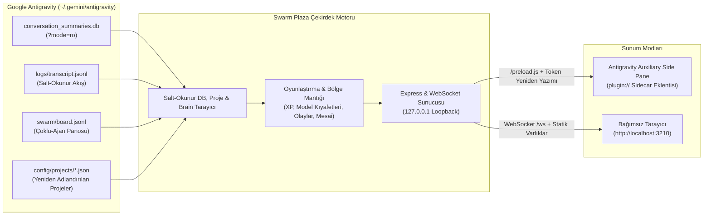

# Antigravity Swarm Plaza 🏢🎮

[](https://github.com/akinba/antigravity-swarm-plaza/actions/workflows/ci.yml)
[](https://github.com/akinba/antigravity-swarm-plaza/releases)

[🇬🇧 **English Documentation**](README.md) | 🇹🇷 **Türkçe Dokümantasyon**

> Google Antigravity projelerindeki otonom ajanları bir plazanın katlarındaki gerçek ofis çalışanları gibi gösteren 2.5B retro izometrik oyunlaştırılmış gösterge paneli ve yerleşik IDE Yan Panel (Auxiliary Pane) eklentisi.

---

## 📸 Görsel Vitrin / Showcase Gallery

| 🏢 Ana 2.5B İzometrik Ofis (Gündüz) | 📱 IDE Yan Panel Kompakt Görünüm | 🌙 Alternatif Kat Planı & Gece Teması |
| :---: | :---: | :---: |
|  |  |  |
| *Yönetici masası, çalışma öbekleri, asansör girişi ve evcil hayvanlar* | *< 760px Aux Pane kompakt araç çubuğu, asansör çekmecesi ve %100 ofis* | *Merkez Toplantı Adası, Gece modu aydınlatması ve Kat Pizza Partisi* |

| 🏙️ Plaza Kulesi Dış Görünüm | 🕸️ Swarm Panosu & `@mention` Ağı | 📊 60 Dakikalık Analitik & Telemetri |
| :---: | :---: | :---: |
|  |  |  |
| *Şirket katları, aktif pencereler ve animasyonlu cam asansör* | *Canlı mesaj akışı ve yönlü `@mention` etkileşim ağı grafiği* | *60 dakikalık aktivite çubukları, görev tamamlama ve model dağılımı* |

---

## 🏛️ Mimari / Architecture



---

## 🌟 Temel Yetenekler & Yenilikler (v1.2.0)

- **🧩 Yerleşik Antigravity Yan Panel Eklentisi (Sidecar Extension):**
  - Eklenti olarak kurulduğunda Antigravity IDE içindeki **Auxiliary Side Pane**'de tek tıkla (`sidecar://antigravity-swarm-plaza/swarm_plaza/`) açılır.
  - Antigravity tarafından atanan dinamik port (`ANTIGRAVITY_SIDECAR_WEB_PORT`) ve loopback güvenlik doğrulaması (`127.0.0.1` + `X-Sidecar-Token`) ile çalışır.
  - Electron `plugin://` protokolü altında beyaz ekran oluşmasını önleyen otomatik asset token yeniden yazımı (`rewriteHtmlWithSidecarToken`), `/preload.js` köprüsü ve 1500ms akıllı HTTP yoklama (polling) modu içerir.
  - **Kompakt Yan Panel Arayüzü (`< 760px`):** Genişlik daraldığında kat paneli kayar çekmeceye (`ASANSÖR ▾`) dönüşür, araç çubuğu `⋯` menüsüne toplanır ve ofis sahnesi tam genişlikte net kalır.
- **🏢 Plaza Kulesi & Sabit Asansör Girişi:**
  - Her Antigravity projesi gökdelende bağımsız bir şirket katıdır (`K0` Lobi, `K1..KN` Projeler ve Çatı Katı Demo Penthouse).
  - Kullanıcı tarafından yeniden adlandırılan Antigravity projeleri (`~/.gemini/config/projects/*.json`), kat panosunda orijinal adıyla (örneğin `"Bursa Veriler"`) otomatik görüntülenir.
  - Tüm mimari planlarda sol duvarda sabit asansör girişi (`gx: 0, gy: 6..7`), yaklaşan ajanlara otomatik açılan fırçalanmış çelik sürgülü kapılar ve yumuşak iniş/çıkış animasyonları.
- **👔 BOSS & 8 Modele Özel Kıyafet / Renk Paleti:**
  - Koordinatör ajanlar tüm arayüzde **★ BOSS** olarak gösterilir ve yönetici masasında altın taçla yer alır.
  - 8 farklı model ailesi kendine özgü kıyafet, aksesuar ve renk paletine sahiptir: `argon` (Mor ceket + taç), `hydrogen` (Turkuaz hoodie + kulaklık), `flash` (Zümrüt/Sarı yarış ceketi + vizör), `carbon` (Kırmızı/Beyaz önlük + siber gözlük), `pro` (Lacivert/Altın takım + kravat), `claude` (Kiremit örgü kazak + bere), `gpt` (Petrol balıkçı yaka + kulaklık), `other` (İndigo polo + yaka kartı).
- **📐 5 Mimari Ofis Planı, 5 Masa Stili & Ofis Evcil Hayvanları:**
  - Ahşap ve cam bölme duvarlarla ayrılmış gerçekçi oda yerleşimleri (Yönetici Ofisi, Yazılım & QA Odası, Toplantı Odası, Sunucu Odası ve Dinlenme Salonu) ile ölü alanlarda mini odalar ve köşe dekorları.
  - %100 kameraya dönük (`SE` / `SW`) oturma pozları, alçak masa tablaları (`10px`) ve köşe monitörler sayesinde ajanların yüzleri ve ifadeleri daima görünür kalır.
  - 5 tema paleti ile toplam 25 benzersiz düzen kombinasyonu (`🎲 DÜZEN`).
- **☕ Canlı Ajan Yaşam Döngüsü & Mesai Bitişi (`AGY_GO_HOME_MINUTES`):**
  - **Masada Seated Coding:** Ergonomik tekerlekli sandalyede klavyede yazma, havada süzülen kod glifleri (`</>`, `{}`).
  - **Toplantı Odası (War Room) & Işınlanma:** Aktif konuşan ajan elinde lazer çubukla sunum ekranında mimari akışları sunar (`presenting`), davet edilen takım arkadaşları 2.5B piksel ışınlanma sütunu ve izometrik halkalarla (`playTeleportZap()`) doğrudan masaya ışınlanır veya dinleyici olarak oturur (`meeting`).
  - **Koltukta Dinlenme & 2 Kişilik Konsol Oyunu:** Bekleyen ajanlar kanepede dinlenir (`lounging`), ikili eşleşerek retro TV'de konsol dövüş/yarış oyunu oynar (`gaming`).
  - **Eve Gidiş:** `8` dakika boyunca pasif kalan ajanlar asansöre yönelir (`going_home`), `9.5` dakika sonra asansöre binerek mesaiyi tamamlar (`offDutyCount`).
- **⚡ Rastgele Ofis Olayları & Kostüm Partileri (`⚡ OLAY` & 65s Otomatik Döngü):**
  - Her ajan için 4 deterministik kostüm varyantı, ortam parçacıkları ve senkronize 96x96 RPG portreleriyle `STAR_WARS_PARTY` (Jedi, Sith, Rebel, Mandalorian), `SUPERHERO_PARTY` ve `HALLOWEEN_PARTY` (Cadı, Balkabağı, Vampir, Hayalet) kostüm partilerinin yanı sıra `PIZZA_PARTY`, `WATERCOOLER_GOSSIP`, `SPRINT_CELEBRATION`, `MASCOT_ZOOMIES` ve `COFFEE_BREW`.
  - *Gerçek İş Bütünlüğü:* Aktif çalışan ajanlar (`working`) asla masalarından veya görevlerinden koparılmaz.
- **📡 Canlı Swarm Board, `@mention` Grafiği & 60dk Analitik:**
  - Hem yerel Swarm `board.jsonl` hem de subagent/görev `messages/*.json` verilerinden beslenen birleşik mesaj akışı ve yönlü `@mention` etkileşim grafiği (`WhiteboardModal`).
  - Son 60 dakikalık aktivite zaman çizelgesi (5 dakikalık 12 dilim), tamamlanan görev sayıları ve model dağılımı (`AnalyticsModal`).
- **🌐 Otomatik Tarayıcı Dili Algılama & Eksiksiz i18n:**
  - Tarayıcı veya sistem dili Türkçe ise otomatik `TR`, aksi halde `EN` olarak başlar. Tek tıkla `TR | EN` anında tüm sunucu konuşma balonlarını, demo şirket adlarını ve olay başlıklarını dinamik yerelleştirir.
- **🛡️ %100 Salt-Okunur (Read-Only) Güvenli Mimari:**
  - `~/.gemini/antigravity` dizinindeki hiçbir dosya veya oturum değiştirilmez, silinmez veya kilitlenmez. SQLite salt-okunur (`?mode=ro`) açılır.

---

### 📐 Mimari Planlar & Evcil Hayvan Tablosu

| Plan No | Mimari Plan Adı | Masa Stili | Bölme Duvarlar | Ofis Evcil Hayvanı & Donanımı |
| :--- | :--- | :--- | :--- | :--- |
| **0** | **Klasik Köşe Stüdyo** | `clover_desk` (4'lü Yonca Pod) | Cam Bölmeler | Akvaryum (Yüzen balıklar & kabarcıklar) |
| **1** | **Merkez Toplantı Adası** | `single_desk` (Bağımsız Masalar) | Ahşap Bölmeler | Tekir Kedi (`tabby_cat`) & Rahat Minderler |
| **2** | **Açık L-Plan Lab** | `bench_desk` (Startup Sıra Masa) | Karma Bölmeler | Robot Süpürge (`robo_vac`) & Masa Tenisi |
| **3** | **Çift Kanat Kurumsal** | `u_pod_desk` (U Takım Adası) | Ofis Cam Bölmeleri | Ofis Köpeği (`office_dog` - Corgi) |
| **4** | **Yaratıcı Loft** | `twin_desk` (İkili Çalışma Masası) | Tuğla & Ahşap | Smokin Kedi (`tuxedo_cat`), Bonsai & Akvaryum |

---

### ⚡ Tek Komutla Çalıştırma (`npx`)

Kurulum veya derleme yapmadan doğrudan çalıştırın (Node.js `>= 22.5.0` gerekir):

```bash
npx antigravity-swarm-plaza
```

#### Komut Satırı Bayrakları (CLI Flags)

| Bayrak | Kısa | Açıklama |
| :--- | :--- | :--- |
| `--demo` | `-d` | Demo modu açık başlatır (örnek 5 model ajanı ve simüle swarm trafiği) |
| `--port <n>` | `-p <n>` | Özel HTTP/WS portu belirler (varsayılan: `3210` veya `$PORT`) |
| `--no-open` | | Tarayıcıyı başlangıçta otomatik açmaz |
| `--workspace <yol>` | `-w <yol>` | Belirli bir çalışma alanı dizinini aktif kat olarak öne çıkarır |
| `--install-plugin` | | Eklentiyi `~/.gemini/config/plugins/antigravity-swarm-plaza` dizinine kurar |
| `--help` | `-h` | Komut satırı yardımını gösterir |
| `--version` | `-v` | Sürüm numarasını yazdırır |

---

### 🧩 Antigravity Eklenti Kurulumu (IDE Sidecar)

Dashboard'u doğrudan Google Antigravity içinden bir Auxiliary Pane yan panel eklentisi ve skill olarak kullanmak için:

```bash
npx antigravity-swarm-plaza --install-plugin
```

Kurulum sonrasında Antigravity sohbetinde şu komutla paneli anında açabilirsiniz:
- `[Swarm Plaza](sidecar://antigravity-swarm-plaza/swarm_plaza/)`
- Eklenti kurulu ve etkinken paketle gelen `plugin/rules/AGENTS.md` kuralı sayesinde `Open the Swarm UI` butonunun yanında otomatik olarak eşlikçi `[Swarm Plaza](sidecar://antigravity-swarm-plaza/swarm_plaza/)` pill bağlantısı da sunulur (eklenti devre dışı bırakıldığında otomatik olarak kalkar).

---

### 🚀 Kaynaktan Geliştirme ve Test

```bash
# Depoyu klonlayın
git clone https://github.com/akinba/antigravity-swarm-plaza.git
cd antigravity-swarm-plaza

# Bağımlılıkları yükleyin
npm install

# Testleri çalıştırın (66 test / 25 test paketi)
npm test

# TypeScript tip kontrolü
npm run typecheck

# İstemci, sunucu ve sidecar paketini derleyin
npm run build

# Yerel sunucuyu başlatın
npm start
```

---

### ⚙️ Ortam Değişkenleri (Environment Variables)

| Değişken | Varsayılan | Açıklama |
| :--- | :--- | :--- |
| `PORT` | `3210` | Standalone web sunucusu ve WebSocket portu |
| `ANTIGRAVITY_SIDECAR_WEB_PORT` | | Antigravity tarafından yan panel için dinamik atanan port (önceliklidir) |
| `HOST` | `127.0.0.1` | Güvenlik amacıyla yalnızca yerel ağ döngüsüne (loopback) bağlanır |
| `AGY_DATA_DIR` | `~/.gemini/antigravity` | Antigravity ana veri dizini (Salt-okunur taranır) |
| `AGY_WORKSPACE` | `process.cwd()` | Etkin proje katını belirlemek için çalışma dizini |
| `AGY_GO_HOME_MINUTES` | `8` | Ajanların asansörle mesaiyi bitirme eşik süresi (dakika) |

---

### 📄 Lisans

MIT. Google Antigravity Çoklu-Ajan Ekosistemi için geliştirilmiştir.
