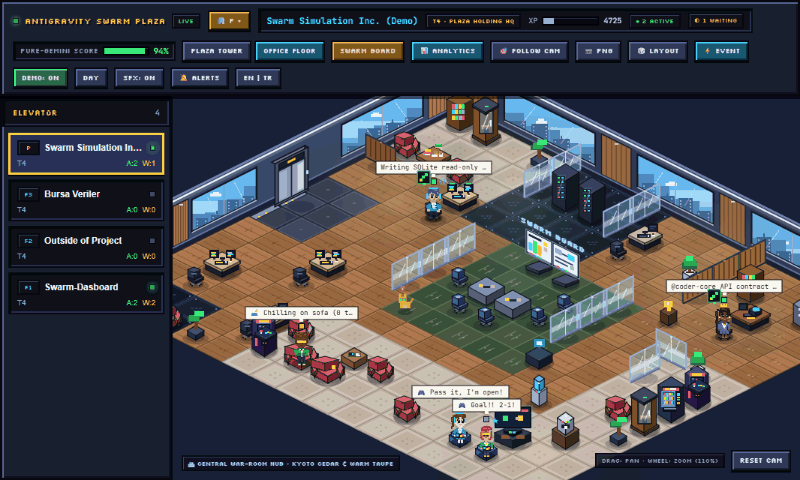
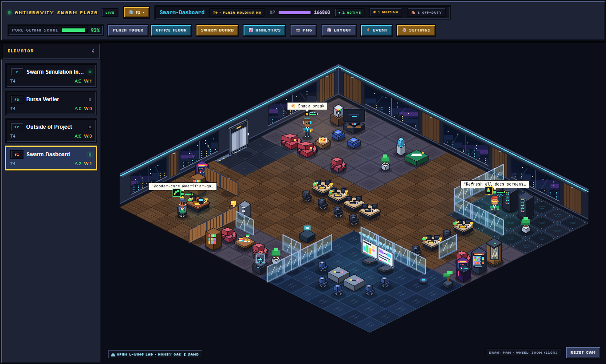
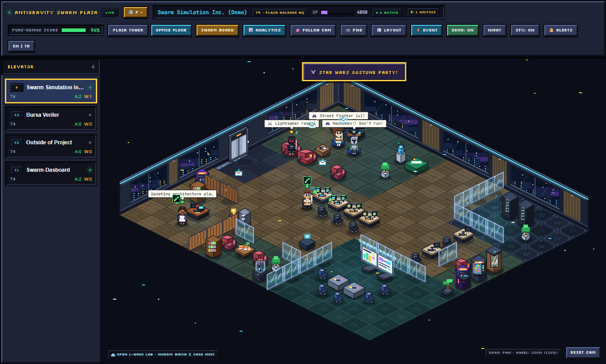
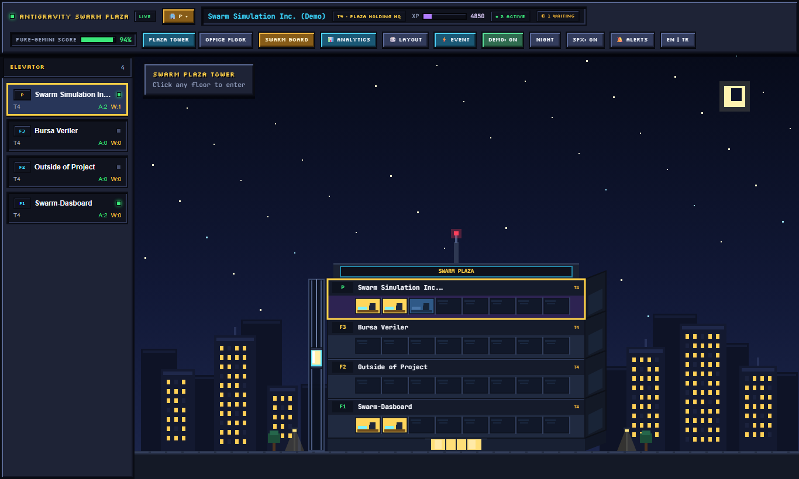
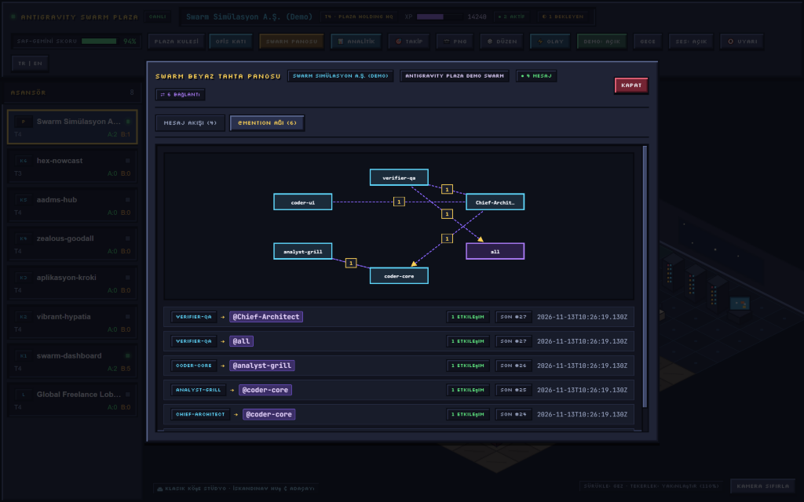
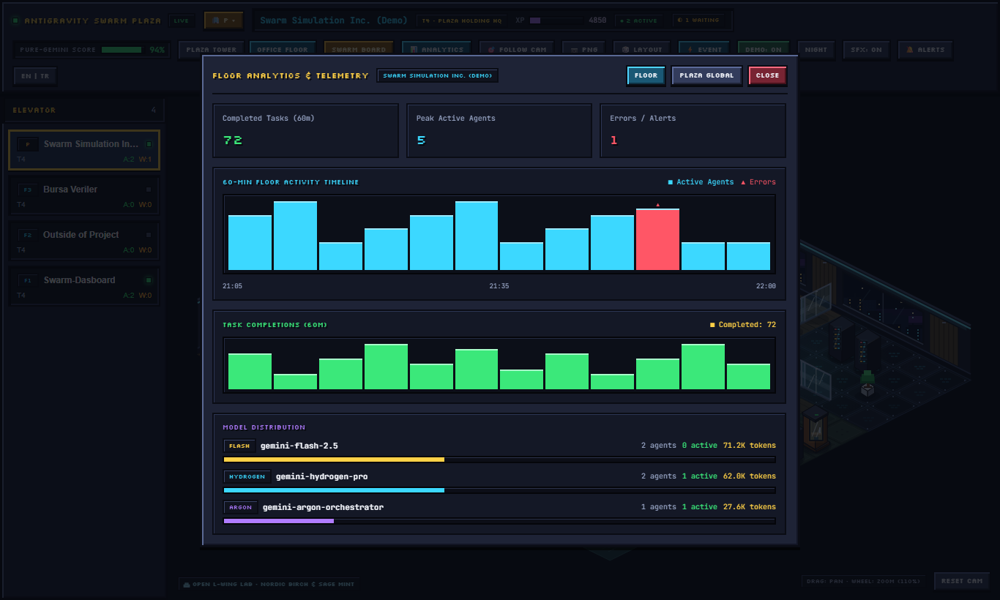
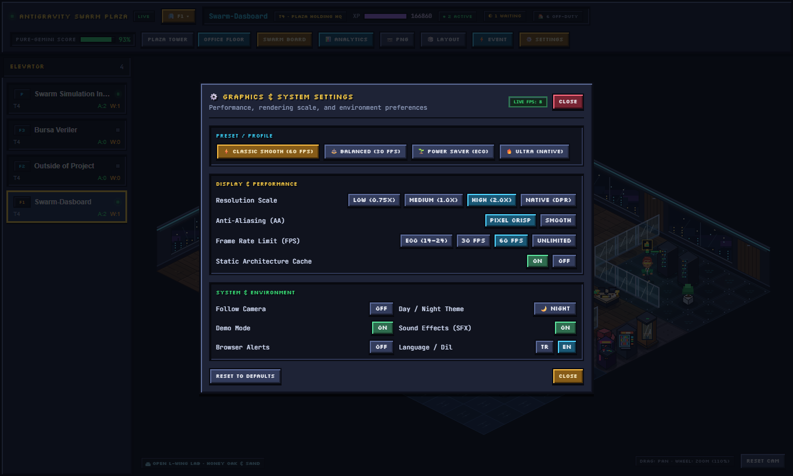
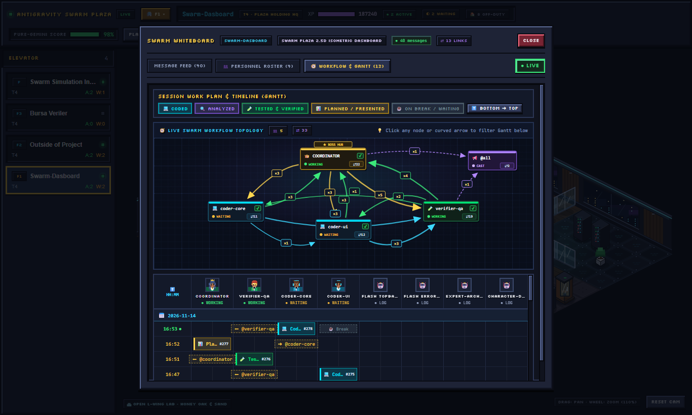
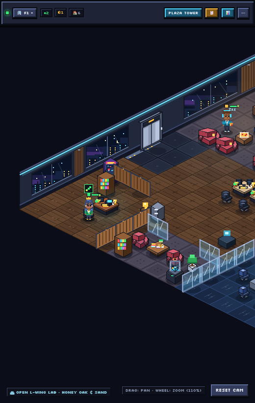
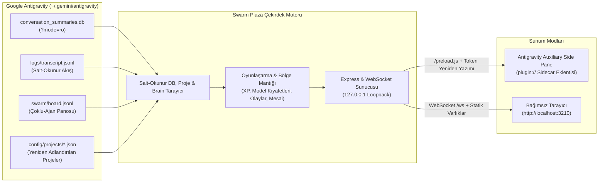

# Antigravity Swarm Plaza 🏢🎮

[](https://github.com/akinba/antigravity-swarm-plaza/actions/workflows/ci.yml)
[](https://github.com/akinba/antigravity-swarm-plaza/releases)


[🇬🇧 **English**](README.md) | 🇹🇷 **Türkçe** | [🇨🇳 **简体中文**](README.zh-CN.md)

> Google Antigravity projelerindeki otonom ajanları bir plazanın katlarındaki gerçek ofis çalışanları gibi gösteren 2.5B retro izometrik oyunlaştırılmış gösterge paneli ve yerleşik IDE Yan Panel (Auxiliary Pane) eklentisi.

---

## 📸 Görsel Vitrin / Showcase Gallery

<p align="center">
  
</p>
<p align="center">
  <em>🎬 <strong>Canlı Demo Turu</strong> — 2.5B Gündüz Ofisi → Gece Modu &amp; Star Wars Kostüm Partisi → Plaza Kulesi Dış Görünümü.</em>
</p>

<p align="center">
  
</p>
<p align="center">
  <em>🏢 <strong>Ana 2.5B İzometrik Ofis (Gündüz)</strong> — Akustik ahşap panelli duvarlar, panoramik şehir manzaralı pencereler, zarif kadın &amp; atletik erkek piksel çalışanlar, çift monitörlü masalar ve mini-oda mobilyaları.</em>
</p>

<table>
  <tr>
    <td width="50%" align="center">
      <strong>🌙 Alternatif Kat Planı, Gece Modu &amp; Olaylar</strong><br /><br />
      <br />
      <em>Alternatif 16×14 kat düzeni, radyal gece ambiyans ışıkları ve canlı kat etkinlikleri</em>
    </td>
    <td width="50%" align="center">
      <strong>🏙️ Plaza Kulesi Dış Gökdelen Görünümü</strong><br /><br />
      <br />
      <em>Çelik kayıtlı cam giydirme cephe, neon SWARM PLAZA tacı, çift katlı cam lobi ve asansör</em>
    </td>
  </tr>
  <tr>
    <td width="50%" align="center">
      <strong>🕸️ Canlı Swarm Panosu &amp; <code>@mention</code> Ağı</strong><br /><br />
      <br />
      <em>Otomatik kaydırmalı mesaj akışı, tıklanabilir <code>● LIVE</code> takibi ve yönlü <code>@mention</code> grafiği</em>
    </td>
    <td width="50%" align="center">
      <strong>📊 60 Dakikalık Analitik &amp; Telemetri</strong><br /><br />
      <br />
      <em>60 dakikalık aktivite çubukları, tamamlanan görev sayacı ve model dağılımı</em>
    </td>
  </tr>
  <tr>
    <td width="50%" align="center">
      <strong>⚙️ Oyun Tarzı Grafik &amp; Sistem Ayarları</strong><br /><br />
      <br />
      <em>Tek tık FPS/DPR profilleri (60 FPS Eski Akıcı varsayılan), AA, statik önbellek ve sistem tercihleri</em>
    </td>
    <td width="50%" align="center">
      <strong>📅 Dikey Gantt &amp; Swarm Beyaz Tahta</strong><br /><br />
      <br />
      <em>Yan yana ajan sütunları, gerçek tarih blokları, HH:MM zaman çizelgesi ve Resimli Personel Listesi</em>
    </td>
  </tr>
</table>

<table>
  <tr>
    <td width="310" align="center">
      
    </td>
    <td valign="middle">
      <strong>📱 IDE Yan Panel Kompakt Görünüm (<code>&lt; 760px</code>)</strong>
      <ul>
        <li><strong>Kompakt Araç Çubuğu:</strong> İkincil kontroller otomatik olarak düzenli bir <code>⋯</code> menüsüne toplanır.</li>
        <li><strong>Açılır Kat Çekmecesi:</strong> Kat seçici paneli yer tasarrufu için hızlı bir <code>ASANSÖR ▾</code> çekmecesine dönüşür.</li>
        <li><strong>Tam Genişlik 2.5B Ofis:</strong> Dar IDE yan panellerinde bile %100 net ve akıcı izometrik sahne sunar.</li>
        <li><strong>Eşlikçi Gezinme Hapı:</strong> Paketle gelen <code>plugin/rules/AGENTS.md</code> kuralı, <code>Open the Swarm UI</code> yanında <code>[Swarm Plaza](sidecar://antigravity-swarm-plaza/swarm_plaza/)</code> bağlantısını sunar.</li>
      </ul>
    </td>
  </tr>
</table>

---

## 🏛️ Mimari / Architecture



---

## 🌟 Temel Yetenekler & Yenilikler (v1.3.1)

- **⚙️ Oyun Tarzı Grafik & Sistem Ayarları + Sadeleştirilmiş Üst Bar:**
  - Tek tıkla seçilebilen hazır performans profilleri (**`⚡ Eski Akıcı 60 FPS`** varsayılan, `⚖️ Dengeli 30 FPS`, `🌱 Güç Tasarrufu Eco`, `🔥 Ultra Native`), Çözünürlük Ölçeği (`0.75x` / `1.0x` / `2.0x` / `Native DPR`), Kenar Düzeltme (`Piksel Keskin` / `Yumuşak Smooth`), Kare Hızı Limiti (`Eco 14–24` / `30` / `60` / `Sınırsız`), Statik Mimari Önbelleği anahtarı ve **Canlı FPS** göstergesi içeren **`⚙️ AYARLAR`** penceresi.
  - Masaüstü üst barı sadece temel kat ve gezinme eylemleriyle sadeleştirildi; `Takip Kamerası`, `Gece/Gündüz`, `Demo Modu`, `SFX`, `Tarayıcı Bildirimleri` ve `TR/EN` tercihleri `localStorage` kalıcılığıyla Ayarlar penceresine taşındı.

- **👥 Resimli Personel Listesi (`👥 PERSONEL LİSTESİ`) & `⬅ LİSTEYE DÖN` RPG Geçişi:**
  - Kattaki her aktif ajan için canlı `64×64` 2.5B piksel portreler, güncel görev/aktivite özeti, model rozeti, `~Tahmini` kredi ve token kullanımı, `HP` sağlık çubuğu ve tek tıkla açılan RPG Kartı içinde doğrudan listeye dönmeyi sağlayan sol üst **`⬅ LİSTEYE DÖN`** butonu.
- **📅 Dikey Gantt İş Planı (`📅 İŞ PLANI (GANTT)`):**
  - Yatay eksende yan yana ajan sütunları, dikey eksende gerçek tarih bloğu (`📅 YYYY-MM-DD`) ve `HH:MM` saat:dakika zaman çizelgesi, renkli faz blokları (`📊 Plan`, `🔍 Analiz`, `💻 Kod`, `🧪 Test`, `☕ Mola`) ile **`⬆️/⬇️` akış yönü değiştirici**.
- **📋 Görev Akışı (`📋 GÖREV AKIŞI (DAG)`) & Masa Üstü Altın Doğrulama Kupaları:**
  - Yalnızca sahnedeki aktif ajanları içeren `@mention` devir grafiği, görev kartları ve `PASS / DONE / EXIT 0 / ✅` kanıt anahtar kelimeleri eşleştiğinde 2.5B masaların üzerinde beliren altın piksel doğrulama kupası (`drawDeskVerifiedTrophy`).
- **🛡️ Ajan Sağlık & Güvenilirlik (`0–100 HP`), `~Tahmini` Maliyet Monitörü & `×N` Akıllı Uyarı Gruplama:**
  - Ajan kartlarında ve masalarda pasif mikro-HP barları, `AnalyticsModal` içinde `~Tahmini` kaynak ve maliyet dağılımı, tekrarlayan uyarıları `×N` rozetiyle gruplayan filtreli bildirim merkezi.
- **⚡ Eco-Canvas GPU Optimizasyonu & Akıllı Mola Etkinlikleri:**
  - Offscreen statik mimari önbelleği + Adaptive FPS Limiter (`0 FPS` gizli sekme, `4 FPS` modal açıkken, `14–24 FPS` aktif sahne) ile ~%85 daha düşük GPU tüketimi; otomatik sosyal/kostüm etkinlikleri için katta en az 2 molada ajan (`MIN_BREAK_AGENTS_FOR_SOCIAL_EVENT = 2`) ve `150 sn` etkinlikler arası bekleme süresi kuralı.

- **🧩 Yerleşik Antigravity Yan Panel Eklentisi (Sidecar Extension):**
  - Eklenti olarak kurulduğunda Antigravity IDE içindeki **Auxiliary Side Pane**'de tek tıkla (`sidecar://antigravity-swarm-plaza/swarm_plaza/`) açılır.
  - Antigravity tarafından atanan dinamik port (`ANTIGRAVITY_SIDECAR_WEB_PORT`) ve loopback güvenlik doğrulaması (`127.0.0.1` + `X-Sidecar-Token`) ile çalışır.
  - Electron `plugin://` protokolü altında beyaz ekran oluşmasını önleyen otomatik asset token yeniden yazımı (`rewriteHtmlWithSidecarToken`), `/preload.js` köprüsü ve 1500ms akıllı HTTP yoklama (polling) modu içerir.
  - **Kompakt Yan Panel Arayüzü (`< 760px`):** Genişlik daraldığında kat paneli kayar çekmeceye (`ASANSÖR ▾`) dönüşür, araç çubuğu `⋯` menüsüne toplanır ve ofis sahnesi tam genişlikte net kalır.
- **🏢 Plaza Kulesi & Sabit Asansör Girişi:**
  - Her Antigravity projesi gökdelende bağımsız bir şirket katıdır (`K0` Lobi, `K1..KN` Projeler ve Çatı Katı Demo Penthouse).
  - Kullanıcı tarafından yeniden adlandırılan Antigravity projeleri (`~/.gemini/config/projects/*.json`), kat panosunda orijinal adıyla (örneğin `"Bursa Veriler"`) otomatik görüntülenir.
  - Tüm mimari planlarda sol duvarda sabit asansör girişi (`gx: 0, gy: 6..7`), yaklaşan ajanlara otomatik açılan fırçalanmış çelik sürgülü kapılar ve yumuşak iniş/çıkış animasyonları.
- **👔 BOSS, Kadın & Erkek Piksel Karakterler ve 8 Modele Özel Kıyafet:**
  - Koordinatör ajanlar tüm arayüzde **★ BOSS** olarak gösterilir ve yönetici masasında altın taçla yer alır.
  - Zarif kadın ve atletik V-taper erkek 2.5B piksel çalışanlar (oval chibi yüz, göz parıltısı, dalgalı/küt/at kuyruğu/balerin topuzu saçlar, 3 kademeli kloş etek; erkeklerde `classic_suit`, `tech_hoodie`, `vest_ensemble` kıyafetleri, 4 katmanlı hacimli saç, odaklı bakışlar ve isteğe bağlı `light_stubble` kirli sakal) + senkronize `96×96` RPG karakter portreleri.
  - 8 farklı model ailesi kendine özgü kıyafet, aksesuar ve renk paletine sahiptir: `argon` (Mor ceket + taç), `hydrogen` (Turkuaz hoodie + kulaklık), `flash` (Zümrüt/Sarı yarış ceketi + vizör), `carbon` (Kırmızı/Beyaz önlük + siber gözlük), `pro` (Lacivert/Altın takım + kravat), `claude` (Kiremit örgü kazak + bere), `gpt` (Petrol balıkçı yaka + kulaklık), `other` (İndigo polo + yaka kartı).
- **📐 Tam 2.5B Ofis Mimarisi, Ambiyans Işıklandırması & 5 Mini-Oda Mobilyası:**
  - Parke/halı/perfore metal/mermer zemin dokuları, akustik ahşap panelli ve panoramik şehir manzaralı arka duvarlar, çift monitörlü bevel masalar, ergonomik koltuklar, espresso barı, yumuşak temas gölgeleri, pencere/sunucu/lounge radyal ışık havuzları ve yenilenen `PLAZA TOWER` cam giydirme gökdelen cephesi.
  - Ahşap ve cam bölme duvarlarla ayrılmış gerçekçi oda yerleşimleri (Yönetici Ofisi, Yazılım & QA Odası, Toplantı Odası, Sunucu Odası ve Dinlenme Salonu) ile `16×14` katlardaki ölü alanları dolduran 5 özel 2.5B mini-oda mobilyası (`phone_booth`, `snack_vending`, `arcade_cabinet`, `library_table`, `3d_printer`).
  - %100 kameraya dönük (`SE` / `SW`) oturma pozları, alçak masa tablaları (`10px`) ve köşe monitörler sayesinde ajanların yüzleri ve ifadeleri daima görünür kalır.
  - 5 tema paleti ile toplam 25 benzersiz düzen kombinasyonu (`🎲 DÜZEN`).
- **☕ Canlı Ajan Yaşam Döngüsü & Mesai Bitişi (`AGY_GO_HOME_MINUTES`):**
  - **Masada Seated Coding:** Ergonomik tekerlekli sandalyede klavyede yazma, havada süzülen kod glifleri (`</>`, `{}`).
  - **Toplantı Odası (War Room) & Işınlanma:** Aktif konuşan ajan elinde lazer çubukla sunum ekranında mimari akışları sunar (`presenting`), davet edilen takım arkadaşları 2.5B piksel ışınlanma sütunu ve izometrik halkalarla (`playTeleportZap()`) doğrudan masaya ışınlanır veya dinleyici olarak oturur (`meeting`).
  - **Koltukta Dinlenme & 2 Kişilik Konsol Oyunu:** Bekleyen ajanlar kanepede dinlenir (`lounging`), ikili eşleşerek retro TV'de konsol dövüş/yarış oyunu oynar (`gaming`).
  - **Eve Gidiş:** `8` dakika boyunca pasif kalan ajanlar asansöre yönelir (`going_home`), `9.5` dakika sonra asansöre binerek mesaiyi tamamlar (`offDutyCount`).
- **⚡ Rastgele Ofis Olayları & Kostüm Partileri (`⚡ OLAY` & 65s Otomatik Döngü):**
  - Her ajan için 4 deterministik kostüm varyantı, ortam parçacıkları ve senkronize 96x96 RPG portreleriyle `STAR_WARS_PARTY` (Jedi, Sith, Rebel, Mandalorian), `SUPERHERO_PARTY` ve `HALLOWEEN_PARTY` (Cadı, Balkabağı, Vampir, Hayalet) kostüm partilerinin yanı sıra `PIZZA_PARTY`, `WATERCOOLER_GOSSIP`, `SPRINT_CELEBRATION`, `MASCOT_ZOOMIES` ve `COFFEE_BREW`.
  - *Gerçek İş Bütünlüğü:* Aktif çalışan ajanlar (`working`) asla masalarından veya görevlerinden koparılmaz.
- **📡 Canlı Swarm Board, `@mention` Grafiği & 60dk Analitik:**
  - Hem yerel Swarm `board.jsonl` hem de subagent/görev `messages/*.json` verilerinden beslenen birleşik mesaj akışı; en yeni mesaja otomatik kaydırma (`MESAJ AKIŞI`), tıklanabilir `● CANLI TAKİP` düğmesi, `@Swarm Worker (...)` rozet normalizasyonu, yönlü `@mention` etkileşim grafiği (`WhiteboardModal`) ve **`GÖREV AKIŞI (DAG)`** sekmesi (mesaj anahtar kelime kanıt doğrulaması: `PASS`, `DONE`, `EXIT 0`, `VERIFIED`, `✅`).
  - **Operasyonel AI Ajan Yönetim Merkezi:** Pasif **Agent Health (0–100 HP)** mikro barları, doğrulanmış masalar için altın kanıt kupası, `~Tahmini` (`~Estimated`) Ajan Token & Maliyet Monitörü (`AnalyticsModal`) ve Akıllı Bildirim Gruplama (`×N` rozeti + önem filtresi).
  - Son 60 dakikalık aktivite zaman çizelgesi (5 dakikalık 12 dilim), tamamlanan görev sayıları ve model dağılımı (`AnalyticsModal`).
- **🌐 Otomatik Tarayıcı Dili Algılama & Eksiksiz i18n:**
  - Tarayıcı veya sistem dili Türkçe ise otomatik `TR`, aksi halde `EN` olarak başlar. Tek tıkla `TR | EN` anında tüm sunucu konuşma balonlarını, demo şirket adlarını ve olay başlıklarını dinamik yerelleştirir.
- **🛡️ %100 Salt-Okunur (Read-Only) Güvenli Mimari:**
  - `~/.gemini/antigravity` dizinindeki hiçbir dosya veya oturum değiştirilmez, silinmez veya kilitlenmez. SQLite salt-okunur (`?mode=ro`) açılır.

---

### 📐 Mimari Planlar & Evcil Hayvan Tablosu

| Plan No | Mimari Plan Adı | Masa Stili | Bölme Duvarlar | Ofis Evcil Hayvanı & Donanımı |
| :--- | :--- | :--- | :--- | :--- |
| **0** | **Klasik Köşe Stüdyo** | `clover_desk` (4'lü Yonca Pod) | Cam Bölmeler | Akvaryum (Yüzen balıklar & kabarcıklar) |
| **1** | **Merkez Toplantı Adası** | `single_desk` (Bağımsız Masalar) | Ahşap Bölmeler | Tekir Kedi (`tabby_cat`) & Rahat Minderler |
| **2** | **Açık L-Plan Lab** | `bench_desk` (Startup Sıra Masa) | Karma Bölmeler | Robot Süpürge (`robo_vac`) & Masa Tenisi |
| **3** | **Çift Kanat Kurumsal** | `u_pod_desk` (U Takım Adası) | Ofis Cam Bölmeleri | Ofis Köpeği (`office_dog` - Corgi) |
| **4** | **Yaratıcı Loft** | `twin_desk` (İkili Çalışma Masası) | Tuğla & Ahşap | Smokin Kedi (`tuxedo_cat`), Bonsai & Akvaryum |

---

### ⚡ Tek Komutla Çalıştırma (`npx`)

#### Tek Komutla Dene (Klonlamadan)

Depoyu klonlamadan veya manuel derleme yapmadan doğrudan çalıştırın (Node.js `>= 22.5.0` gerekir):

```bash
# Doğrudan GitHub üzerinden etkileşimli demo modunda çalıştırın
npx github:akinba/antigravity-swarm-plaza --demo

# Veya npm paketi olarak çalıştırın
npx antigravity-swarm-plaza --demo
```

#### Komut Satırı Bayrakları (CLI Flags)

| Bayrak | Kısa | Açıklama |
| :--- | :--- | :--- |
| `--demo` | `-d` | Demo modu açık başlatır (örnek 5 model ajanı ve simüle swarm trafiği) |
| `--port <n>` | `-p <n>` | Özel HTTP/WS portu belirler (varsayılan: `3210` veya `$PORT`) |
| `--no-open` | | Tarayıcıyı başlangıçta otomatik açmaz |
| `--workspace <yol>` | `-w <yol>` | Belirli bir çalışma alanı dizinini aktif kat olarak öne çıkarır |
| `--install-plugin` | | Eklentiyi `~/.gemini/config/plugins/antigravity-swarm-plaza` dizinine kurar |
| `--help` | `-h` | Komut satırı yardımını gösterir |
| `--version` | `-v` | Sürüm numarasını yazdırır |

---

### 🧩 Antigravity Eklenti Kurulumu (IDE Sidecar)

Dashboard'u doğrudan Google Antigravity içinden bir Auxiliary Pane yan panel eklentisi ve skill olarak kullanmak için:

```bash
npx antigravity-swarm-plaza --install-plugin
```

Kurulum sonrasında Antigravity sohbetinde şu komutla paneli anında açabilirsiniz:
- `[Swarm Plaza](sidecar://antigravity-swarm-plaza/swarm_plaza/)`
- Eklenti kurulu ve etkinken paketle gelen `plugin/rules/AGENTS.md` kuralı sayesinde `[Open the Swarm UI](sidecar://swarm/swarm_board/)` butonunun yanında otomatik olarak eşlikçi `[Swarm Plaza](sidecar://antigravity-swarm-plaza/swarm_plaza/)` pill bağlantısı da sunulur (eklenti devre dışı bırakıldığında otomatik olarak kalkar).

---

### 🚀 Kaynaktan Geliştirme ve Test

```bash
# Depoyu klonlayın
git clone https://github.com/akinba/antigravity-swarm-plaza.git
cd antigravity-swarm-plaza

# Bağımlılıkları yükleyin
npm install

# Testleri çalıştırın (73 test / 25 test paketi)
npm test

# TypeScript tip kontrolü
npm run typecheck

# İstemci, sunucu ve sidecar paketini derleyin
npm run build

# Yerel sunucuyu başlatın
npm start
```

---

### ⚙️ Ortam Değişkenleri (Environment Variables)

| Değişken | Varsayılan | Açıklama |
| :--- | :--- | :--- |
| `PORT` | `3210` | Standalone web sunucusu ve WebSocket portu |
| `ANTIGRAVITY_SIDECAR_WEB_PORT` | | Antigravity tarafından yan panel için dinamik atanan port (önceliklidir) |
| `HOST` | `127.0.0.1` | Güvenlik amacıyla yalnızca yerel ağ döngüsüne (loopback) bağlanır |
| `AGY_DATA_DIR` | `~/.gemini/antigravity` | Antigravity ana veri dizini (Salt-okunur taranır) |
| `AGY_WORKSPACE` | `process.cwd()` | Etkin proje katını belirlemek için çalışma dizini |
| `AGY_GO_HOME_MINUTES` | `8` | Ajanların asansörle mesaiyi bitirme eşik süresi (dakika) |

---

### 📄 Lisans

MIT. Google Antigravity Çoklu-Ajan Ekosistemi için geliştirilmiştir.
