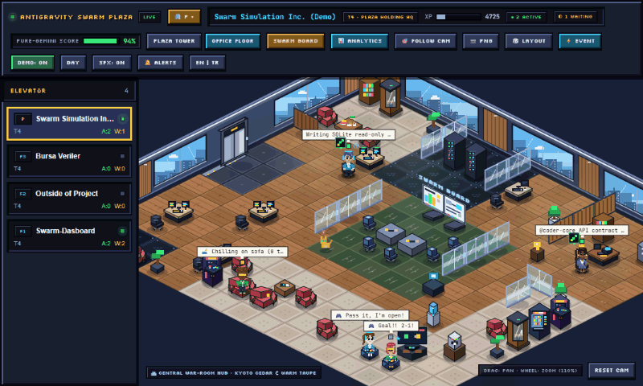
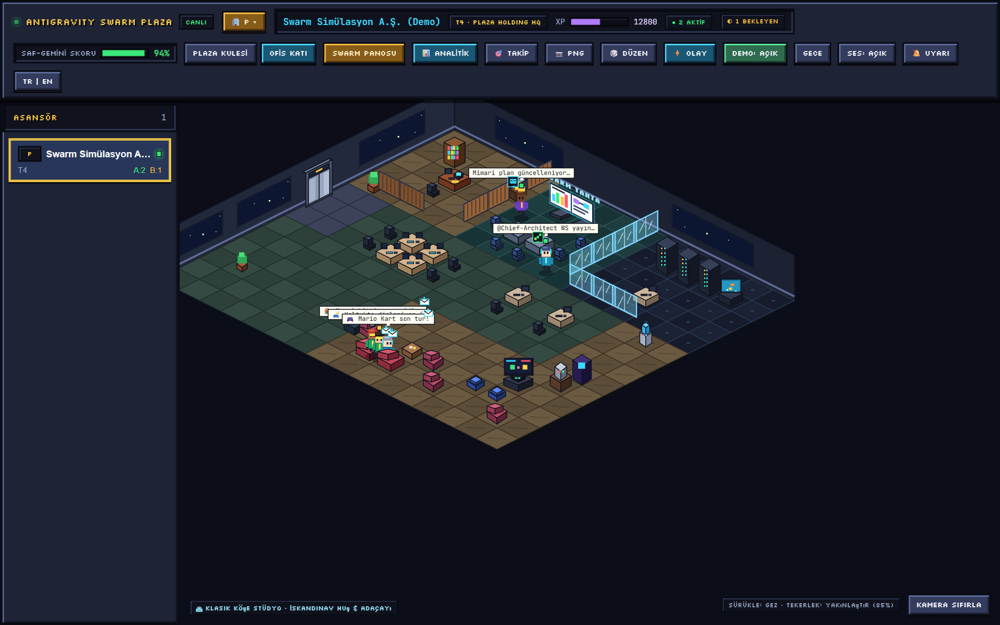
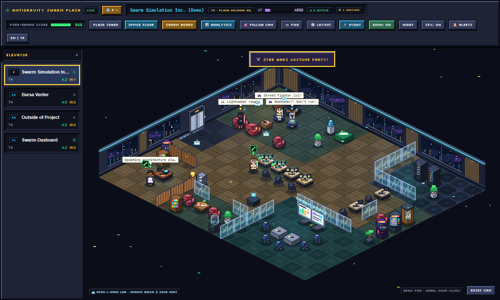
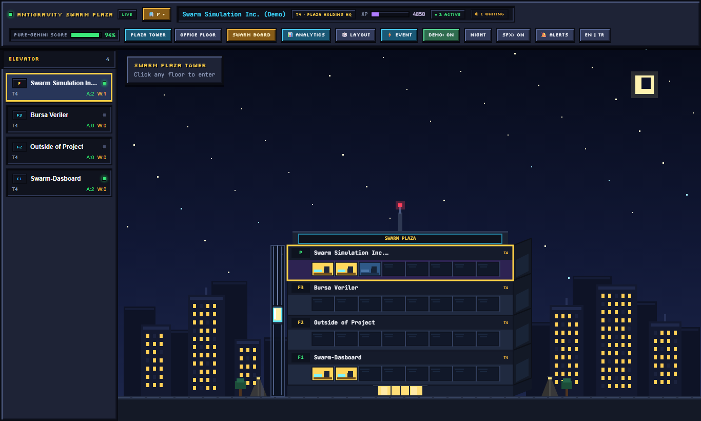
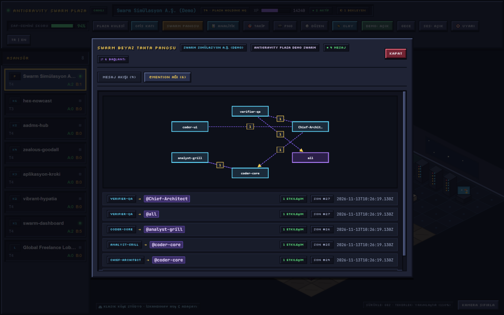
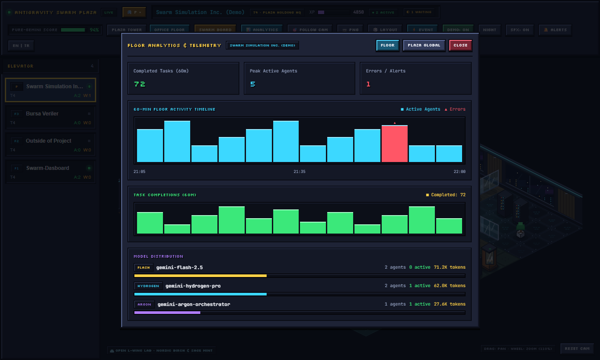
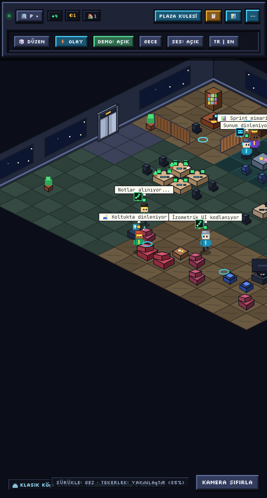
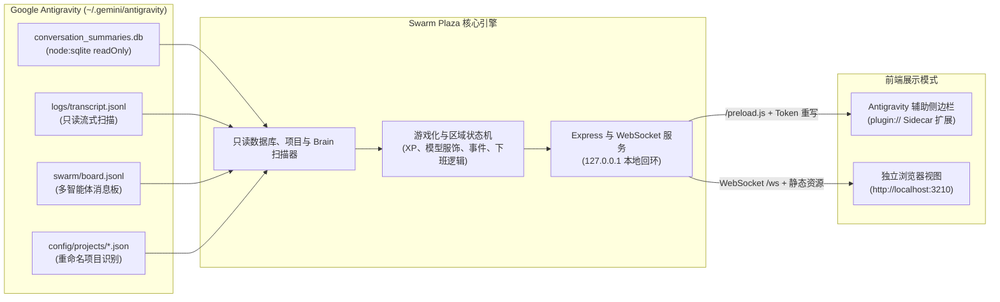

<div align="center">

# Antigravity Swarm Plaza 🏢🎮

[](https://github.com/akinba/antigravity-swarm-plaza/actions/workflows/ci.yml)
[](https://github.com/akinba/antigravity-swarm-plaza/releases)


[🇬🇧 **English**](README.md) | [🇹🇷 **Türkçe**](README.tr.md) | 🇨🇳 **简体中文**

> 一款 2.5D 复古像素等距视角游戏化监控面板与原生 IDE 侧边栏（Auxiliary Pane）扩展插件，将 Google Antigravity 多智能体系统（Swarm）可视化为摩天大楼各楼层中鲜活工作的办公室员工。

</div>

---

## 📸 界面展示画廊 (Visual Showcase Gallery)

<p align="center">
  
</p>
<p align="center">
  <em>🎬 <strong>实时演示动图</strong> — 2.5D 日间办公室 → 夜间模式与星球大战换装派对 → 广场大楼外观。</em>
</p>

<p align="center">
  
</p>
<p align="center">
  <em>🏢 <strong>主界面 2.5D 等距办公室（日间）</strong> — 声学木格栅墙面、全景城市天际线窗户、精致男女像素员工、双屏办公桌与迷你房间家具。</em>
</p>

<table>
  <tr>
    <td width="50%" align="center">
      <strong>🌙 备用蓝图、夜间模式与楼层活动</strong><br /><br />
      <br />
      <em>备用 16×14 楼层布局、夜间径向环境光效与实时楼层派对活动</em>
    </td>
    <td width="50%" align="center">
      <strong>🏙️ 广场大楼外观视图</strong><br /><br />
      <br />
      <em>钢肋玻璃幕墙、楼顶霓虹 SWARM PLAZA 标志、挑高玻璃大堂与观光电梯</em>
    </td>
  </tr>
  <tr>
    <td width="50%" align="center">
      <strong>🕸️ Swarm 白板与 <code>@mention</code> 关系网</strong><br /><br />
      <br />
      <em>自动滚动消息流、可点击 <code>● LIVE</code> 实时追踪按钮与有向 <code>@mention</code> 拓扑图</em>
    </td>
    <td width="50%" align="center">
      <strong>📊 60 分钟活动分析与遥测</strong><br /><br />
      <br />
      <em>60 分钟活动柱状图、已完成任务统计与多模型分布视图</em>
    </td>
  </tr>
</table>

<table>
  <tr>
    <td width="310" align="center">
      
    </td>
    <td valign="middle">
      <strong>📱 IDE 辅助侧边栏紧凑模式（<code>&lt; 760px</code>）</strong>
      <ul>
        <li><strong>紧凑工具栏：</strong> 次要操作按钮自动收拢进整洁的 <code>⋯</code> 菜单。</li>
        <li><strong>滑出式楼层抽屉：</strong> 楼层选择器折叠为快捷电梯抽屉，最大化节省横向空间。</li>
        <li><strong>全宽 2.5D 办公室：</strong> 即使在窄侧边栏中也能保持 100% 清晰的等距画布视野。</li>
        <li><strong>伴随导航胶囊：</strong> 内置 <code>plugin/rules/AGENTS.md</code> 规则会在 <code>Open the Swarm UI</code> 旁自动提供 <code>[Swarm Plaza](sidecar://antigravity-swarm-plaza/swarm_plaza/)</code> 入口。</li>
      </ul>
    </td>
  </tr>
</table>

---

## 🏛️ 系统架构 (Architecture Diagram)



---

## 🌟 核心特性 (Core Features & v1.2.0)

- **🧩 嵌入式 Antigravity 侧边栏插件 (Sidecar Extension):**
  - 安装后可在 Antigravity IDE 的 **Auxiliary Side Pane** 中通过 `[Swarm Plaza](sidecar://antigravity-swarm-plaza/swarm_plaza/)` 一键打开。
  - 自动绑定 Antigravity 动态分配端口（`ANTIGRAVITY_SIDECAR_WEB_PORT`），并采用 `127.0.0.1` 本地回环安全策略与 `X-Sidecar-Token` 鉴权。
  - 内置透明静态资源 Token 重写（`rewriteHtmlWithSidecarToken`）、`/preload.js` 桥接脚本及 1500ms HTTP 轮询兜底，确保 Electron `plugin://` 协议下零白屏稳定渲染。
  - **响应式紧凑模式（`< 760px`）：** 窄侧边栏自动将楼层列表折叠为抽屉（`ASANSÖR ▾`），次要操作收入 `⋯` 菜单，保持 100% 全宽等距画布视野。
- **🏢 广场摩天大楼与固定电梯厅：**
  - 每个 Antigravity 项目映射为大楼的独立楼层（`F0` 大厅、`F1..Fn` 项目层与顶层 Demo 演示层），支持从 `~/.gemini/config/projects/*.json` 自动识别重命名后的工作区名称。
  - 所有 5 套建筑蓝图统一配备左侧固定电梯口（`gx: 0, gy: 6..7`）与拉丝钢自动滑门，员工入职与下班时自动开合。
- **👔 多样化男女 2.5D 像素员工、RPG 肖像与模型服饰：**
  - 精致女性与运动型 V-Taper 男性 2.5D 像素角色：女性配备椭圆 Q 版脸型、眼部高光、长发/波波头/马尾/丸子头与 3 层百褶短裙/剪裁西装；男性提供 3 种服饰风格（`classic_suit`、`tech_hoodie`、`vest_ensemble`）、4 层立体蓬松发型、专注神态及可选轻盈胡茬（`light_stubble`），并与 `96×96` RPG 角色肖像卡实时同步。
  - Swarm 协调者以 **★ BOSS** 身份戴金色皇冠坐镇红木行政桌；8 大模型家族拥有专属装扮：`Argon`（紫金西装+皇冠）、`Hydrogen`（青色卫衣+耳机）、`Flash`（翡翠/金赛车服+护目镜）、`Carbon`（深红实验服+赛博眼镜）、`Pro`（海军蓝/金西装）、`Claude`（陶土针织毛衣+冷帽）、`GPT`（青绿高领+耳麦）、`Other`（靛蓝工装+工牌）。
- **📐 完整 2.5D 办公建筑、氛围光影与 5 种迷你房间家具：**
  - 实木地板/地毯/冲孔金属/大理石纹理地面、吸音木饰面与全景城市天际线背墙、双屏斜切办公桌、人体工学椅与浓缩咖啡吧；搭配柔和接触阴影、窗户/机房/休息区径向光池以及焕新升级的 `PLAZA TOWER` 玻璃幕墙摩天大楼立面。
  - 真实隔断房间布局（行政套房、开发与 QA 区、会议作战室、服务器机房、休息室），并利用 **电话亭**（`phone_booth`）、**零食售货机**（`snack_vending`）、**街机柜**（`arcade_cabinet`）、**阅览桌**（`library_table`）和 **3D 打印机**（`3d_printer`）填充角落与死角区域。
  - 5 套蓝图搭配 5 套主题调色盘，组合出 25 种独特办公室风格（`🎲 LAYOUT`）。
- **⚡ 作战室全息传送 (`⚡`) 与 11 种随机事件 / 主题派对：**
  - **作战室召唤与全息传送：** 协调者发起会议时使用激光教鞭演示；受邀成员触发 2.5D 全息传送光柱、扩散等距光环与 `playTeleportZap()` 8-bit 音效直达会议座。
  - **11 种趣味活动与派对：** 包含 **星球大战**（`STAR_WARS_PARTY` — 绝地/西斯/反抗军/曼达洛人）、**超级英雄**（`SUPERHERO_PARTY`）、**万圣节**（`HALLOWEEN_PARTY` — 女巫/南瓜头/吸血鬼/幽灵）三大主题换装派对（每位员工 4 种变体 + 画布粒子 + RPG 肖像同步），以及 `PIZZA_PARTY`、`WATERCOOLER_GOSSIP`、`SPRINT_CELEBRATION`、`MASCOT_ZOOMIES`、`COFFEE_BREW` 等。工作中的智能体（`status === 'working'`）绝不会被环境事件打断。
  - **8-bit 合成器音效（Chiptune SFX）：** 纯 Web Audio API 零外部音频文件，支持静音持久化。
- **📡 实时 Swarm 白板、`@mention` 网络图与 60 分钟遥测：**
  - 同时汇聚原生 Swarm `board.jsonl` 与子智能体/后台任务 `messages/*.json`（含 `@Swarm Worker (...)` 标签规范化），支持 `MESSAGE FEED` 打开即自动滚动至最新消息、可点击 `● LIVE` 实时追踪按钮以及悬浮未读跳转提示。
  - 有向 `@mention` 交互网络图（`WhiteboardModal`）与 60 分钟活动时间轴、模型分布统计（`AnalyticsModal`）。
  - 支持楼层 `T1..T5` 评级、Pure-Gemini 生态/配额评分、PNG 高清导出、昼夜模式切换与多语言自动识别（`EN` / `TR`）。
- **🛡️ 100% 只读安全架构：**
  - 所有数据源严格只读：`node:sqlite` 以 `{ readOnly: true }` 打开，`transcript.jsonl` 与 `brain` 目录采用只读流扫描，服务仅绑定 `127.0.0.1` 回环地址，绝不修改或锁定 `~/.gemini/antigravity` 中的任何用户数据。

---

## 📐 建筑蓝图与宠物一览 (Blueprints & Pets)

| 编号 | 蓝图名称 | 工位风格 | 隔断样式 | 办公室宠物与设施 |
| :--- | :--- | :--- | :--- | :--- |
| **0** | **Classic Corner Studio** | `clover_desk`（四人四叶草工位） | 玻璃隔断 | 水族箱（游动热带鱼与气泡） |
| **1** | **Central Meeting Island** | `single_desk`（独立宽松工位） | 原木隔断 | 虎斑猫（`tabby_cat`）与懒人沙发 |
| **2** | **Open L-Plan Tech Lab** | `bench_desk`（创业长条工位） | 混合隔断 | 扫地机器人（`robo_vac`）与乒乓球台 |
| **3** | **Dual-Wing Corporate** | `u_pod_desk`（U 型团队岛台） | 全景玻璃墙 | 办公室柯基犬（`office_dog`） |
| **4** | **Creative Penthouse Loft**| `twin_desk`（双人联排工位） | 砖墙与原木 | 奶牛猫（`tuxedo_cat`）、盆栽与水族箱 |

---

## ⚡ 快速开始与命令行参数 (Quick Start & CLI Options)

### 一行命令快速体验（无需克隆）

无需克隆仓库或手动构建，直接运行（需要 Node.js `>= 22.5.0`）：

```bash
# 直接从 GitHub 启动交互式演示模式
npx github:akinba/antigravity-swarm-plaza --demo

# 或通过 npm 包运行
npx antigravity-swarm-plaza --demo
```

| 参数 | 简写 | 说明 |
| :--- | :--- | :--- |
| `--demo` | `-d` | 开启交互式演示模式（5 个 Pure-Gemini 模拟智能体） |
| `--port <n>` | `-p <n>` | 指定 HTTP/WebSocket 端口（默认 `3210` 或 `$PORT`） |
| `--no-open` | | 启动时不自动打开系统默认浏览器 |
| `--workspace <path>` | `-w <path>` | 指定高亮显示的项目工作区路径 |
| `--install-plugin` | | 将插件安装至 `~/.gemini/config/plugins/antigravity-swarm-plaza` |
| `--help` | `-h` | 显示命令行帮助 |
| `--version` | `-v` | 打印当前版本号 |

---

## 🧩 Antigravity IDE 侧边栏插件与快捷入口

将 Swarm Plaza 安装为 Google Antigravity 原生辅助侧边栏扩展与技能：

```bash
npx antigravity-swarm-plaza --install-plugin
```

安装完成后，在 Antigravity 对话中点击侧边栏胶囊即可打开：
- `[Swarm Plaza](sidecar://antigravity-swarm-plaza/swarm_plaza/)`
- 当插件处于安装并启用状态时，内置规则 `plugin/rules/AGENTS.md` 会在原生 `[Open the Swarm UI](sidecar://swarm/swarm_board/)` 胶囊旁自动提供伴随入口 `[Swarm Plaza](sidecar://antigravity-swarm-plaza/swarm_plaza/)`（禁用插件后自动停止提示）。

---

## 🚀 开发与测试 (Development & Testing)

```bash
# 克隆仓库
git clone https://github.com/akinba/antigravity-swarm-plaza.git
cd antigravity-swarm-plaza

# 安装依赖
npm install

# 启动开发模式
npm run dev

# 运行 TypeScript 类型检查
npm run typecheck

# 运行自动化测试（69 个单元测试 / 25 个测试套件）
npm test

# 构建前端、服务端与 Sidecar 单文件包
npm run build

# 启动生产服务
npm start
```

---

## ⚙️ 环境变量 (Environment Variables)

| 变量名 | 默认值 | 说明 |
| :--- | :--- | :--- |
| `PORT` | `3210` | Web 服务与 WebSocket 监听端口 |
| `ANTIGRAVITY_SIDECAR_WEB_PORT` | | Antigravity 为侧边栏分配的动态端口（优先级最高） |
| `HOST` | `127.0.0.1` | 绑定本地回环地址以确保安全 |
| `AGY_DATA_DIR` | `~/.gemini/antigravity` | Antigravity 根目录路径（仅只读扫描） |
| `AGY_WORKSPACE` | `process.cwd()` | 用于识别并高亮当前项目楼层的工作区路径 |
| `AGY_GO_HOME_MINUTES` | `8` | 无活动后员工走向电梯下班的阈值（分钟） |

---

## 📄 开源协议 (License)

基于 **MIT License** 开源。专为 Google Antigravity 多智能体生态设计与打造。
